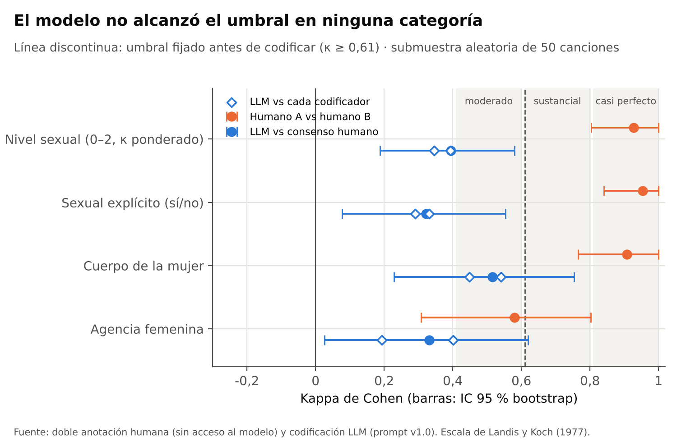
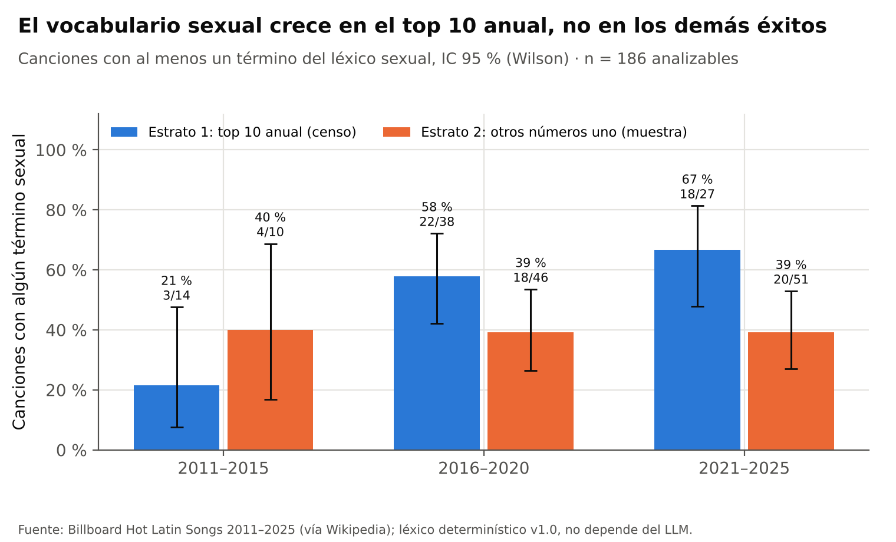

# Estadística del reggaetón

**Contenido sexual, cuerpo y agencia en las letras urbanas latinas más populares, 2011–2025**


Proyecto 3 de **Estadística Industrial** · Ingeniería Industrial · Universidad del Magdalena · 2026-II

---

## Problema

¿Cambió el contenido sexual de las canciones urbanas latinas de mayor éxito entre 2011 y 2025? Responderlo exige medir texto de forma confiable. Por eso el proyecto combina un diseño muestral estratificado con tres instrumentos de medición y **valida un modelo de lenguaje (LLM) frente a codificadores humanos** antes de usar sus resultados.

## Preguntas

- **Principal.** ¿Cambió entre 2011 y 2025 la proporción de canciones con contenido sexual explícito?
- **S1.** ¿Difiere la referencia al cuerpo de la mujer, y la presentación de la mujer como sujeto que decide, según participe o no una intérprete mujer?
- **S2.** ¿Cambió la riqueza léxica de las letras en el tiempo?

## Diseño y metodología

| Componente | Detalle |
|---|---|
| Población | Éxitos de Billboard *Hot Latin Songs*, 2011–2025 |
| Muestreo | Dos estratos: censo de las canciones urbanas o híbridas del top 10 anual (79) y muestra aleatoria, estratificada por periodo, de los demás números uno semanales (107). Corpus final: **186 canciones** |
| Instrumentos | Léxico determinístico de 52 patrones, riqueza léxica MATTR y un LLM con libro de códigos y *prompt* congelados (huellas SHA-256) |
| Validación | Submuestra aleatoria de 50 canciones codificada por dos personas de forma independiente; acuerdo medido con κ de Cohen e IC *bootstrap* |
| Inferencia | Regresión logística (razón de odds por año), correlación de Spearman, tendencias por estrato, tamaños de efecto |

## Resultados principales

| Hallazgo | Resultado |
|---|---|
| Validación del LLM | No superó el umbral en ninguna categoría: κ = 0,32 frente al consenso humano en contenido explícito, contra κ = 0,95 entre los dos codificadores humanos. Sus resultados se reportan solo como exploratorios |
| Contenido sexual (top 10 anual) | Aumentó: razón de odds por año de 1,21 (IC 95 % [1,05; 1,39], p = 0,006) |
| Contenido sexual (otros números uno) | Estable: razón de odds de 0,98 (p = 0,760); la diferencia entre tendencias es significativa (p = 0,026) |
| Riqueza léxica | Aumentó en ambos estratos: +0,0066 puntos de MATTR por año (IC 95 % [0,0038; 0,0093], p < 0,001) |

Los hallazgos son observacionales y describen éxitos del mercado estadounidense: no permiten establecer causas ni efectos sobre las audiencias.

<p align="center">
  
  
</p>

📄 [Informe técnico](entregables/informe_tecnico.pdf) · 🎙️ [Podcast de divulgación](https://youtu.be/H96QXHH8iKg) · 🖥️ [Sustentación (ES)](presentacion/sustentacion_es.pdf) · [Project defense (EN)](presentacion/project_defense_en.pdf)

## Cómo reproducir

```bash
python -m pip install -r requirements.txt     # Python 3.11 o superior
python -m playwright install chromium         # solo la primera vez: genera los PDF
python ejecutar_todo.py                       # unos 2 minutos
```

Antes de correrlo:

1. **Letras.** Coloque `C001.txt` … `C196.txt` en la carpeta `letras/` (C193 no existe: no respuesta, ver `config.SIN_LETRA`), en UTF-8, una letra por archivo. **Esa carpeta no forma parte del repositorio** (`.gitignore`): las letras son obras protegidas. El código las lee en memoria y nunca escribe su texto en disco.
2. **Codificación humana.** Coloque las plantillas diligenciadas en `datos/codificacion_humana/codificador_A.xlsx` y `codificador_B.xlsx` (la ronda anterior queda archivada en `ronda1_estrato1/` y no se usa). `codificador_C.xlsx` es opcional. Sin ellas, el paso 5 avisa que la validación está pendiente y el resto del flujo continúa.

3. **Registros.** `registros/codificacion_llm.csv` (la salida del instrumento LLM, con fecha y vía de cada codificación) y `registros/analisis_discrepancias.md` (el análisis cualitativo de la sección 6.2) son entradas: el flujo las lee y no las regenera.

Todo lo demás (`datos/`, `resultados/`, `entregables/`) se regenera. Se verificó que dos ejecuciones completas desde cero producen, byte a byte, la misma base analítica, los mismos kappas, discrepancias y pruebas. Las fuentes aleatorias son dos semillas definidas en `codigo/config.py`: `SEMILLA = 20261022` (sorteo del estrato 2, bootstrap, permutaciones y figuras) y `SEMILLA_VALIDACION = 20261024` (sorteo de la submuestra de validación).


## Estructura

```
ejecutar_todo.py                 script maestro (pasos 1 a 11)
codigo/
  config.py                      parámetros: rutas, semilla, periodos
  utilidades.py                  normalización de títulos y artistas
  s01_marco_muestral.py          dos marcos, deduplicación, clasificación de género, sorteo del estrato 2, pesos
  s02_variables_texto.py         limpieza en memoria, longitud, MATTR, léxico, idioma
  s03_submuestra_validacion.py   sorteo estratificado (estrato × periodo) de 50 canciones y plantillas
  s04_codificar_llm.py           codificación con el LLM (modo API) y verificación
  s05_validacion.py              kappas con IC bootstrap, matrices, discrepancias, decisión
  s06_inferencia.py              base analítica, pruebas y tamaños de efecto
  s07_graficos.py                figuras del informe
  s08_verificar_letras.py        auditoría: ningún archivo contiene texto de letras
  s09_informe.py                 informe técnico en PDF, con todas las cifras leídas de resultados/
  s10_divulgacion.py             carrusel divulgativo, con cifras leídas de resultados/
  s11_diccionario.py             diccionario de variables de las dos bases CSV (falla si falta una columna)
instrumentos/
  clasificacion_genero_v1.1.csv  clasificación urbano / híbrido / no urbano (v1.0 + estrato 2)
  metadatos_interpretes_v1.1.csv género y país de cada intérprete
  lexico_v1.0.csv                léxico con criterios de inclusión
  libro_codigos_v1.0.md          libro de códigos (categorías del LLM)
  prompt_codificacion_v1.0.txt   prompt fijo de codificación
  HASHES_v1.0.txt                huellas SHA-256 que congelan los instrumentos
datos_crudos/                    fuentes de los marcos (Wikipedia) y lista de letras con fuente y fecha (sin letras)
registros/                       codificación LLM y análisis cualitativo de discrepancias (entradas)
datos/                           salidas intermedias y base_analitica.csv
resultados/                      validación, inferencia y figuras
entregables/                     informe técnico, bitácora de IA, libro de validación, reporte HTML y guion del podcast
presentacion/                    diapositivas de la sustentación (español e inglés)
documentacion/                   diccionario de variables (CSV fuente, Excel y PDF)
letras/                          LOCAL: no se versiona ni se entrega
```


## Reutilizar el léxico y el libro de códigos

`instrumentos/lexico_v1.0.csv` tiene una fila por patrón: `dimension`, `patron` (expresión regular sobre texto en minúsculas, sin tildes y sin apóstrofos de elisión), `tipo` (estándar, variante, jerga, doble sentido, anglicismo) y `criterio`. La función `normalizar()` de `s02_variables_texto.py` prepara el texto en el formato esperado.

`instrumentos/libro_codigos_v1.0.md` define tres categorías con criterios de inclusión y exclusión, ejemplos y contraejemplos. Si alguien modifica cualquiera de los dos, debe crear una versión nueva: la medición cambia.

## Regla de manejo de letras

Ningún archivo de `datos/` ni de `resultados/` contiene texto de letras. Las justificaciones del LLM están limitadas a 30 palabras sin citas de más de 5 palabras seguidas, y el paso 4 verifica ese límite.

## Uso de inteligencia artificial

El LLM se usó como **instrumento de medición** y se validó contra codificación humana (ver resultados). Además, el uso de IA como apoyo durante el proyecto está documentado en la [bitácora de uso de IA](entregables/bitacora_uso_ia.pdf).

## Autoría

Proyecto académico desarrollado en equipo:

- **Camilo Andrés Henríquez Noguera**: análisis de datos y desarrollo del código.
- Mateo Valencia Caro
- Samuel López Álvarez
- Valeria Gutiérrez Núñez

Docente: Enrique J. de la Hoz Domínguez · Universidad del Magdalena.
